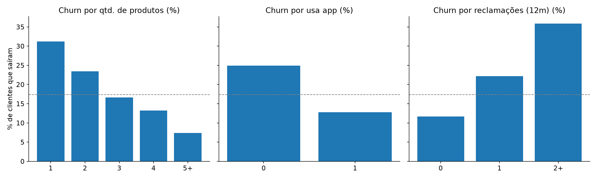

 

**Transformo dados em decisão comercial.**
Vivência real de negócio no mercado financeiro, agora aplicada em análise de dados e BI.

 

 

## ⭐ Projetos em destaque

<table>
  <tr>
    <td width="50%" valign="top">
      
      <h3>📈 Painel Comercial: Meta x Realizado</h3>
      Painel interativo em Excel (filtro por produto, formatação condicional) e Power BI com modelo estrela, medidas DAX, carteira de clientes e roteiro.  
        
    </td>
    <td width="50%" valign="top">
      
      <h3>📊 Análise de Vendas 2025</h3>
      Limpeza de dados, consultas SQL, KPIs, sazonalidade e recomendações comerciais.  
        
    </td>
  </tr>
  <tr>
    <td width="50%" valign="top">
      
      <h3>🔁 Análise de Churn de Clientes</h3>
      Quais fatores levam o cliente a sair e um score de risco explicável para priorizar a ação comercial.  
        
    </td>
    <td width="50%" valign="top">
      
      <h3>🏦 Inadimplência de Crédito (SQL)</h3>
      SQL analítico em carteira de crédito: CTEs, funções de janela, análise por safra e concentração do risco.  
        
    </td>
  </tr>
</table>

Todos os projetos usam dados sintéticos (fictícios), o que está explicado no README de cada um.

---

## 👋 Quem sou

Analista de Dados com uma combinação pouco comum: **vivência real de negócio** (Bradesco e Cielo) e **formação técnica em dados e sistemas**. Conheço o outro lado da planilha: sei quais perguntas o gestor comercial precisa responder, quais indicadores movem a meta e como transformar uma análise em ação.

- 📊 Foco em **análise de dados, BI e automação** aplicados a negócios e finanças
- 🎓 Cursando **Análise e Desenvolvimento de Sistemas** (Universidade São Judas); formado em **Economia, Finanças, Gestão de Riscos e Compliance e Direito**
- 🤖 Estudando **IA aplicada a dados**: certificado **Microsoft Azure AI Fundamentals (AI-900)** e em preparação para a AI-901
- 🗣️ Inglês avançado

## 📈 Resultados de carreira

Entregas em gestão de carteiras e metas, que hoje sei medir, modelar e prever com dados:

| Resultado | Contexto |
|---|---|
| 🏆 **185%** de atingimento de metas por 5 meses seguidos | Carteira de 750 clientes |
| 📈 **+35%** no volume de negócios da carteira em 12 meses | Gerente Exclusive, Bradesco |
| 🤝 **96-97%** de retenção de clientes estratégicos | Segmentos Prime e Exclusive |
| 💳 **118%** de atingimento médio e **-14%** na perda de clientes | Gerente de Negócios, Cielo |
| 🚀 **214%** da meta em campanha de consórcios | Bradesco |

## 🧰 Stack

## 🎓 Formação e certificações

| | |
|---|---|
| 🎓 **Graduação** | Análise e Desenvolvimento de Sistemas, Universidade São Judas (em andamento) |
| ☁️ **Microsoft** | Azure AI Fundamentals (AI-900) |
| 📊 **Dados e BI** | Power BI, análise de dados e data science (Senai); Modelagem e Visualização de Dados com Power BI e Excel Avançado |
| ⚙️ **Automação** | Power Automate / RPA (DIO) |
| 💼 **Mercado financeiro** | ANBIMA CEA, CPA-20 e CPA-10 |

## 🗺️ Próximos projetos

- [ ] Publicar o arquivo **.pbix** do painel comercial no Power BI (2 páginas: painel e carteira de clientes)
- [ ] **Segmentação de clientes** (RFM) com Python

---

### 📫 Vamos conversar?

Aberto a oportunidades em **Análise de Dados, BI e áreas que unam negócio e dados**.

