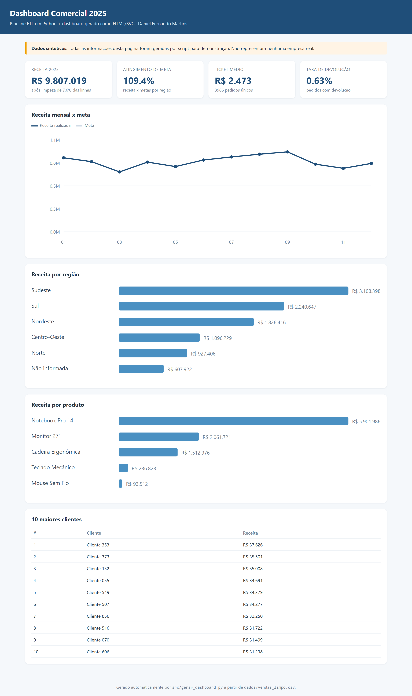
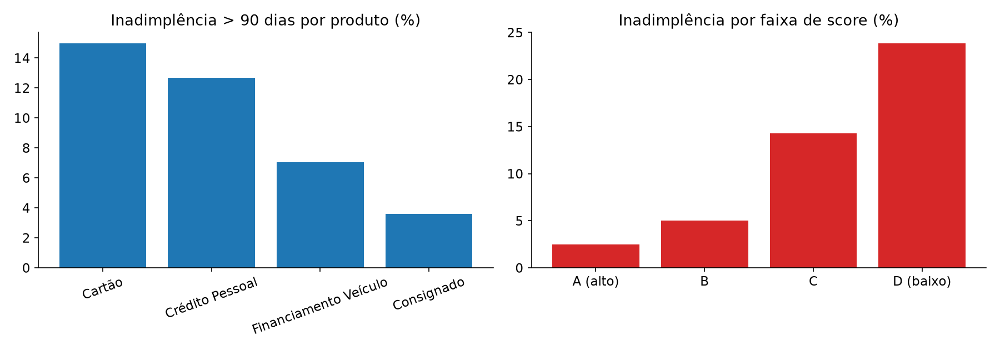

# Daniel Fernando Martins | Analista de Dados Júnior

Profissional com **24 anos de experiência no mercado financeiro**, com trajetória no Bradesco e na Cielo, em transição para Análise de Dados. Combino conhecimento de negócio — carteira, crédito, vendas, metas e retenção — com projetos demonstrativos em **Python, SQL e análise comercial**.

**Objetivo:** Analista de Dados Júnior | BI | Dados aplicados a negócios e finanças

[LinkedIn](https://www.linkedin.com/in/danielfernandomartins) · [Currículo](./CURRICULO.md) · [E-mail](mailto:dfm21031983@gmail.com)

[](https://github.com/danielmartins-data/danielmartins-data/actions/workflows/ci.yml)

---

## 🧭 Para quem está avaliando

Organizei a navegação para facilitar uma avaliação objetiva, seja em recrutamento ou em liderança técnica.

| Se você é recrutador(a) ou RH | Se você é gestor(a) de dados ou tech lead |
|---|---|
| **[Roteiro de 5 minutos](./COMO-AVALIAR.md)** — por onde começar e quais projetos priorizar. | **[Guia técnico de avaliação](./GUIA-TECNICO.md)** — arquitetura, decisões, testes e limitações que podem ser aprofundados em entrevista. |
| **[Currículo](./CURRICULO.md)** — trajetória no mercado financeiro, resultados profissionais, formação e objetivo. | **[Código, dados e testes](./testes/)** — confira implementações, validações e saídas reproduzíveis. |
| **[LinkedIn](https://www.linkedin.com/in/danielfernandomartins)** — histórico profissional e contato. | **[Como contribuir](./CONTRIBUTING.md)** — estrutura, convenção de commits e fluxo de pull request. |

**Transparência:** as bases dos projetos são sintéticas e não representam resultados de empresas reais. Os resultados profissionais descritos no currículo são independentes das análises demonstrativas. As competências listadas abaixo são limitadas ao que está evidenciado por código, documentação ou testes neste repositório.

---
## Projetos selecionados

Estes são os três projetos que melhor demonstram competências diretamente relevantes para uma posição júnior em análise de dados. Os resultados numéricos dos projetos vêm de **bases sintéticas** e não representam resultados de empresas reais.

### 1. Pipeline ETL e qualidade de dados



**Problema:** transformar uma exportação operacional inconsistente em uma base confiável para análise.

- Pipeline em Python para limpeza, padronização e tratamento de registros.
- Log de transformações para rastreabilidade e sete regras de qualidade.
- Persistência em SQLite, consultas de negócio e dashboard HTML gerado por código.
- Testes automatizados verificam regras e saídas do pipeline.

**Demonstra:** Python, pandas, ETL, validação de dados, SQL e comunicação visual.

[Ver código, dados, método e instruções](./pipeline-etl-dashboard/README.md)

### 2. Análise de inadimplência com SQL



**Problema:** identificar onde a inadimplência se concentra e como acompanhar sua evolução.

- Seis consultas comentadas sobre carteira de crédito.
- CTEs, agregações, CASE WHEN, funções de janela (AVG OVER, RANK, NTILE) e subqueries.
- Análises por produto, faixa de score, safra e concentração de exposição.
- Execução reproduzível em SQLite, com geração de tabelas e gráficos.

**Demonstra:** SQL analítico, raciocínio de risco e tradução de indicadores em perguntas de negócio.

[Ver consultas, dados, método e instruções](./analise-inadimplencia-sql/README.md)

### 3. Análise de vendas: do dado bruto à recomendação


**Problema:** analisar desempenho comercial apesar de duplicidades e campos incompletos.

- Limpeza auditável, remoção de duplicidades e tratamento explícito de região ausente.
- Consultas SQL em SQLite para receita por período, produto, região e canal.
- KPIs, gráficos e recomendações comerciais derivadas das análises.
- Registros sem região são preservados em categoria identificada, em vez de descartados.

**Demonstra:** Python/pandas, SQL, qualidade de dados, análise exploratória e comunicação com áreas de negócio.

[Ver código, dados, método e instruções](./analise-vendas/README.md)

---

## Competências demonstradas

| Competência | Evidência no repositório |
|---|---|
| Python e pandas | Limpeza, transformação, análise e geração de saídas nos projetos ETL e Vendas |
| SQL | SQLite, CTEs, funções de janela, agregações e subqueries |
| Qualidade de dados | Regras explícitas, tratamento documentado, logs e testes automatizados |
| Análise de negócio | Indicadores de crédito, vendas, produto, canal e região |
| Comunicação analítica | Resumos executivos, gráficos e recomendações vinculadas aos dados |
| Versionamento e testes | Git, GitHub Actions e suíte pytest |

**Escopo técnico declarado:** SQL demonstrado em SQLite. Não apresento MySQL, PostgreSQL, Power BI ou Tableau como experiência comprovada por entregas publicadas neste portfólio.

---

## Experiência de negócio

**Bradesco — Gerente Exclusive**
- 185% de atingimento de meta por cinco meses consecutivos em carteira de 750 clientes.
- Crescimento de 35% no volume de negócios da carteira em 12 meses.
- Retenção de 96–97% dos clientes estratégicos.
- 214% da meta em campanha de consórcios.

**Cielo — Gerente de Negócios**
- 118% de atingimento médio de metas.
- Redução de 14% na perda de clientes.

*Os indicadores acima são resultados da trajetória profissional em gestão comercial; não são resultados dos projetos de dados deste repositório.*

---

## Qualidade e reprodutibilidade

- Instruções para recriar bases e executar as análises em cada projeto.
- Testes automatizados com pytest.
- GitHub Actions configurado para verificar o código em Python 3.10, 3.11 e 3.12.
- Dados dos projetos são sintéticos, gerados para fins demonstrativos; nenhuma informação confidencial de empregadores foi utilizada.

Para executar a suíte:

```bash
pip install -r requirements.txt
pytest -q
```

---

## Formação e certificações

- Análise e Desenvolvimento de Sistemas — Universidade São Judas (em andamento).
- Formação em Economia, Finanças, Gestão de Riscos e Compliance e Direito.
- Microsoft Azure AI Fundamentals (AI-900).
- Cursos de Python, bancos de dados, modelagem de dados, Power BI e Excel avançado.
- Certificações ANBIMA CEA, CPA-20 e CPA-10.

---

## Contato

Estou aberto a oportunidades de **Analista de Dados Júnior**, especialmente em times que conectem dados, operações, crédito, vendas e resultados de negócio.

[LinkedIn](https://www.linkedin.com/in/danielfernandomartins) · [Currículo](./CURRICULO.md) · [dfm21031983@gmail.com](mailto:dfm21031983@gmail.com)
