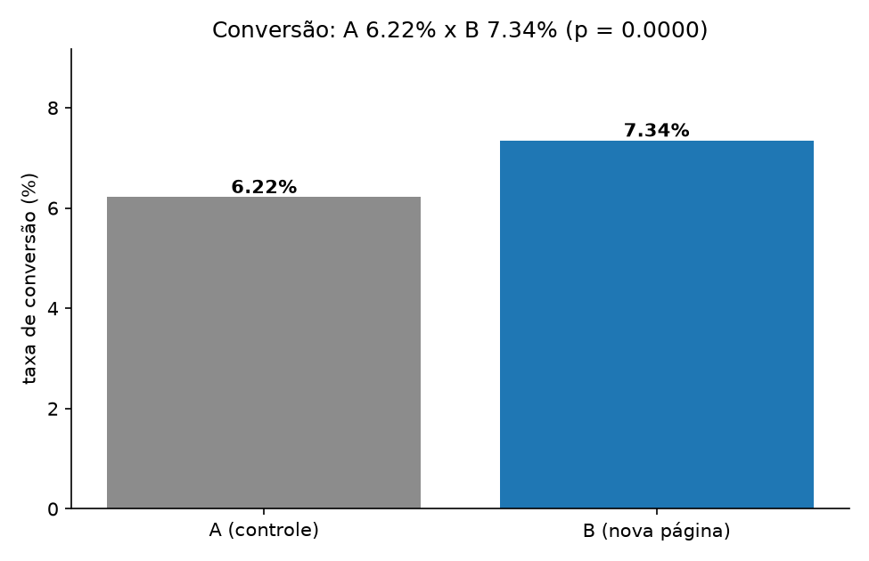
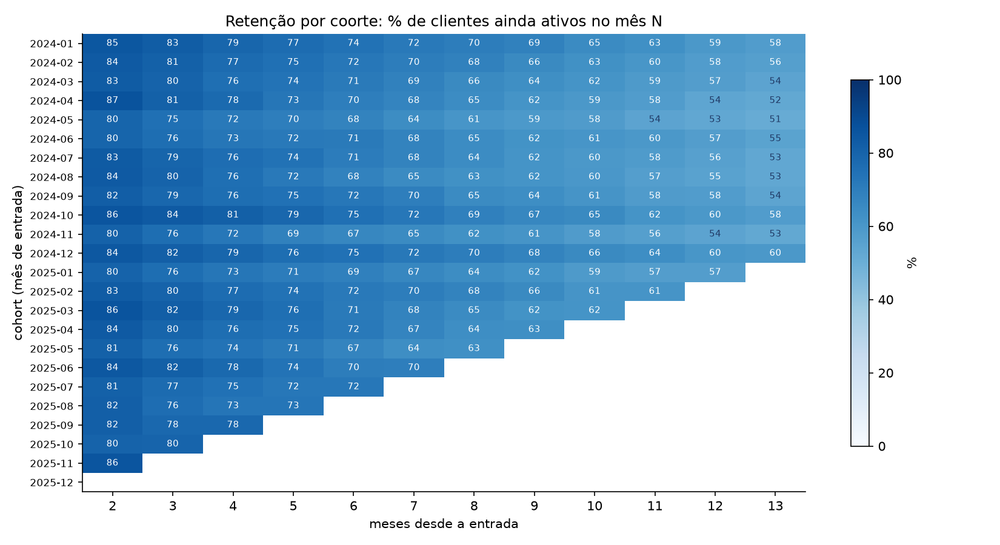
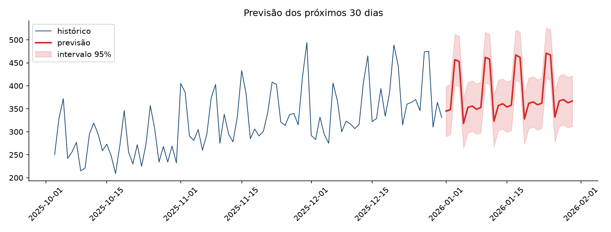
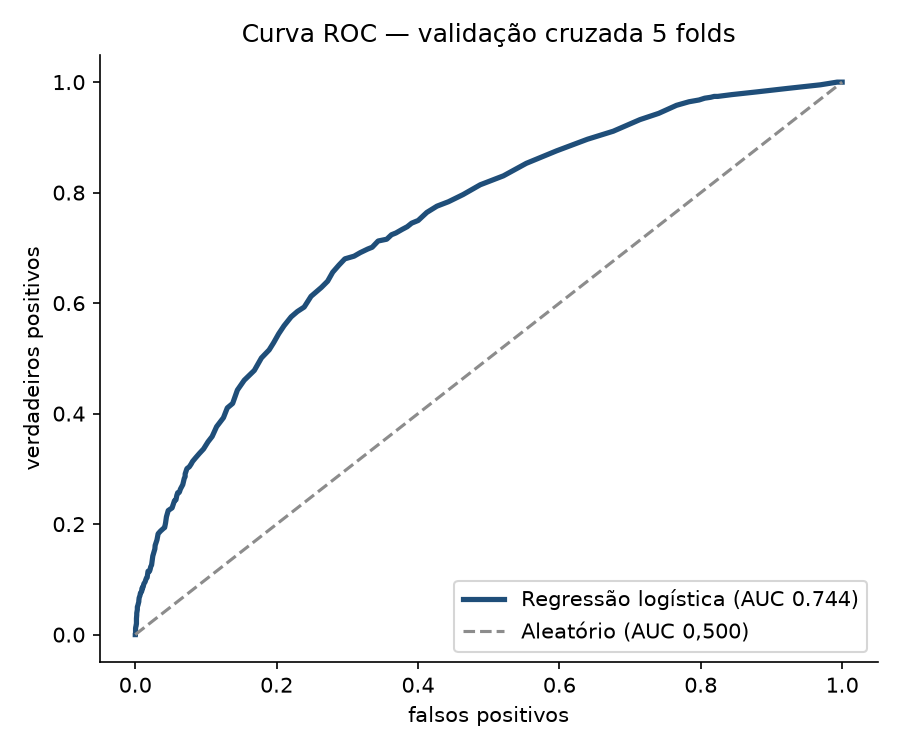
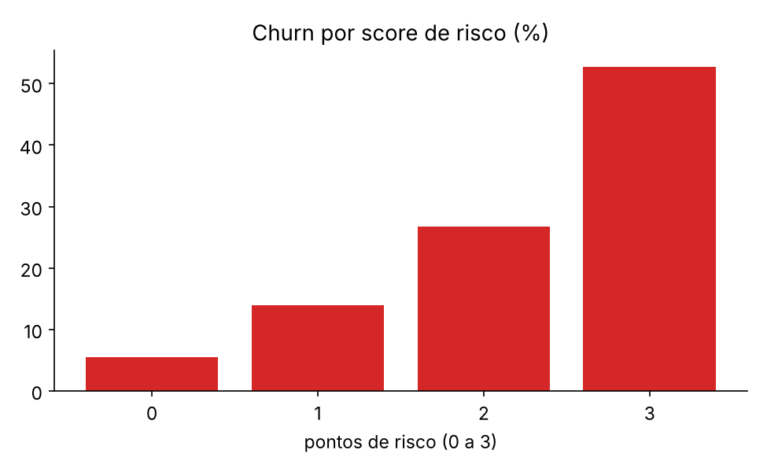
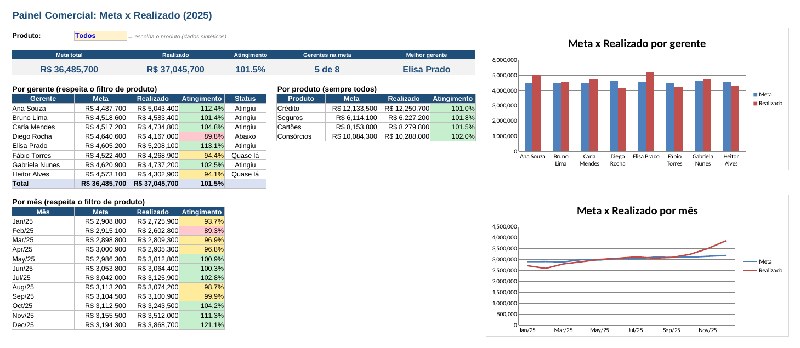

<div align="center">


<br><br>

[](https://github.com/danielmartins-data/danielmartins-data/actions/workflows/ci.yml)
[](./testes)
[](./COMO-AVALIAR.md)
[](https://www.linkedin.com/in/danielfernandomartins)
[](./LICENSE)
[](./.github/workflows/ci.yml)
[](./COMO-AVALIAR.md)

[](https://www.linkedin.com/in/danielfernandomartins)
[](mailto:dfm21031983@gmail.com)
[](./CURRICULO.md)

**Transformo dados em decisão comercial.**
24 anos de experiência no mercado financeiro (Bradesco e Cielo), em transição para análise de dados e BI.

<sub>🇬🇧 *Financial-services professional with 24 years of business experience, transitioning into data analytics. Portfolio projects demonstrate SQL, Python, BI and customer analytics. Advanced English.*</sub>

<br>


<br>

**👉 Recrutador com 5 minutos?** Comece pelo [roteiro de avaliação](./COMO-AVALIAR.md) — ou abra direto o [dashboard gerado por código](./pipeline-etl-dashboard/dashboard.html).

<br>

<table>
<tr>
<td align="center" width="25%"><b>10</b><br><sub>projetos demonstrativos</sub></td>
<td align="center" width="25%"><b>28</b><br><sub>testes automatizados</sub></td>
<td align="center" width="25%"><b>3</b><br><sub>versões de Python no CI</sub></td>
<td align="center" width="25%"><b>0</b><br><sub>dados reais expostos</sub></td>
</tr>
</table>

</div>

<br>

## 🔎 Em 30 segundos

| | |
|---|---|
| 🎯 **Busco** | Vaga de **Analista de Dados Júnior** ou BI, com foco em negócios, vendas e finanças |
| 💡 **Diferencial** | 24 anos de experiência no mercado financeiro: entendo a pergunta de negócio, a meta e o cliente — não só a ferramenta |
| 🧰 **Ferramentas** | SQL (SQLite) · Python (pandas) · Excel · Power BI/DAX documentados (.pbix pendente) · R · Git/GitHub; Tableau em roteiro
| 📂 **Provas** | **10 projetos demonstrativos**, com pergunta de negócio, método, documentação e instruções de execução |
| ✅ **Qualidade** | Suite pytest e CI configurado para Python 3.10–3.12; quantidade e status atuais devem ser conferidos no Actions |
| 📫 **Contato** | [LinkedIn](https://www.linkedin.com/in/danielfernandomartins) · [dfm21031983@gmail.com](mailto:dfm21031983@gmail.com) |

---

## 🧭 Para quem está avaliando

<table>
<tr>
<td width="50%" valign="top">

**Se você é recrutador(a) ou RH**

- Comece pelo [roteiro de 5 minutos](./COMO-AVALIAR.md) — tem o que abrir e em qual ordem.
- [Currículo em uma página](./CURRICULO.md), com contato e stack.
- Toda competência citada tem um link que prova: código, base, resultado e teste.
- Os dados são **sintéticos** e isso está avisado em todos os projetos.

</td>
<td width="50%" valign="top">

**Se você é gestor(a) de dados ou tech lead**

- [Guia de entrevista](./docs/GUIA-ENTREVISTA.md): a narrativa, as perguntas difíceis e o que eu assumo como ponto fraco.
- Cada projeto tem teste que valida **as saídas**, não só "se rodou".
- [Como contribuir](./CONTRIBUTING.md): padrão de projeto, convenção de commit e fluxo de PR.
- Modelos e métricas feitos do zero (teste z, regressão logística) para mostrar conceito, não `import`.

</td>
</tr>
</table>

---

## ⭐ Portfólio em destaque

<table>
<tr><td width="50%" valign="top">
<a href="https://github.com/danielmartins-data/danielmartins-data/tree/main/pipeline-etl-dashboard"></a>

### 🏗️ Pipeline ETL + Dashboard

Base “suja” do ERP: 7,6% das linhas tratadas e justificadas, 7 regras de qualidade e um dashboard executivo gerado por código.

**109,4% da meta · R$ 9,81 mi de receita**

   

<a href="https://github.com/danielmartins-data/danielmartins-data/tree/main/pipeline-etl-dashboard"><b>Ver projeto →</b></a>
</td><td width="50%" valign="top">
<a href="https://github.com/danielmartins-data/danielmartins-data/tree/main/analise-teste-ab"></a>

### 🧪 Teste A/B de conversão

Teste z implementado do zero: p-valor, intervalo de confiança, poder estatístico e o impacto do ganho em receita por ano.

**+1,13 p.p. na base sintética · p < 0,0001**

 

<a href="https://github.com/danielmartins-data/danielmartins-data/tree/main/analise-teste-ab"><b>Ver projeto →</b></a>
</td></tr>
  <tr><td width="50%" valign="top">
<a href="https://github.com/danielmartins-data/danielmartins-data/tree/main/analise-cohort-retencao"></a>

### 🔄 Retenção de assinantes (coorte)

Matriz de coorte em SQL, churn mensal e LTV por plano e canal de aquisição, com o viés das coortes recentes corrigido.

**56,8% de retenção no 12º mês**

  

<a href="https://github.com/danielmartins-data/danielmartins-data/tree/main/analise-cohort-retencao"><b>Ver projeto →</b></a>
</td><td width="50%" valign="top">
<a href="https://github.com/danielmartins-data/danielmartins-data/tree/main/previsao-demanda"></a>

### 🚀 Previsão de demanda

Holt-Winters contra baseline sazonal, validação temporal e MAE, MAPE e WAPE — inclusive quando o modelo simples ganha.

**WAPE de 15,6% na base sintética · horizonte de 30 dias**

 

<a href="https://github.com/danielmartins-data/danielmartins-data/tree/main/previsao-demanda"><b>Ver projeto →</b></a>
</td></tr>
  <tr><td width="50%" valign="top">
<a href="https://github.com/danielmartins-data/danielmartins-data/tree/main/analise-risco-credito"></a>

### 🧮 Score de risco de churn (modelo)

Regressão logística implementada do zero, validação cruzada 5 folds, AUC, KS e curva de ganho — comparada com a regra de negócio.

**Comparação por validação cruzada; métricas recalculadas na execução**

 

<a href="https://github.com/danielmartins-data/danielmartins-data/tree/main/analise-risco-credito"><b>Ver projeto →</b></a>
</td><td width="50%" valign="top">
<a href="https://github.com/danielmartins-data/danielmartins-data/tree/main/analise-churn-clientes"></a>

### 🔁 Churn de clientes

Análise exploratória de fatores de churn e um score de risco explicável, com a lista de prioridade para o comercial.

**Score separa 5,5% de 52,8% de churn**

 

<a href="https://github.com/danielmartins-data/danielmartins-data/tree/main/analise-churn-clientes"><b>Ver projeto →</b></a>
</td></tr>
  <tr><td width="50%" valign="top">
<a href="https://github.com/danielmartins-data/danielmartins-data/tree/main/analise-inadimplencia-sql"></a>

### 🏦 Inadimplência de crédito

Seis consultas de SQL analítico: CTEs, funções de janela, safra com média móvel e concentração do risco.

**46,8% da perda em 37 contratos**

  

<a href="https://github.com/danielmartins-data/danielmartins-data/tree/main/analise-inadimplencia-sql"><b>Ver projeto →</b></a>
</td><td width="50%" valign="top">
<a href="https://github.com/danielmartins-data/danielmartins-data/tree/main/analise-vendas"></a>

### 📊 Análise de vendas 2025

Do CSV bruto à recomendação: limpeza, KPIs, sazonalidade e comparação entre canal e região.

**R$ 4,10 mi · ticket R$ 1.932**

 

<a href="https://github.com/danielmartins-data/danielmartins-data/tree/main/analise-vendas"><b>Ver projeto →</b></a>
</td></tr>
  <tr><td width="50%" valign="top">
<a href="https://github.com/danielmartins-data/danielmartins-data/tree/main/painel-comercial-excel-powerbi"></a>

### 📈 Painel Comercial (Excel + Power BI)

Painel funcional em Excel (SUMIFS, lista suspensa e formatação condicional); modelo estrela e medidas DAX documentados. Arquivo .pbix ainda não publicado.

**Meta x realizado por produto**

  

<a href="https://github.com/danielmartins-data/danielmartins-data/tree/main/painel-comercial-excel-powerbi"><b>Ver projeto →</b></a>
</td><td width="50%" valign="top">
<a href="https://github.com/danielmartins-data/danielmartins-data/tree/main/segmentacao-rfm-r-tableau"></a>

### 🎯 Segmentação RFM (R + Tableau)

Notas por quintil, 7 segmentos e plano de ação — em R base, com versão equivalente em Python e roteiro do Tableau.

**Campeões: 18% dos clientes, 50% do valor**

  

<a href="https://github.com/danielmartins-data/danielmartins-data/tree/main/segmentacao-rfm-r-tableau"><b>Ver projeto →</b></a>
</td></tr>
</table>

<sub>Todos os projetos usam **dados sintéticos** (fictícios), o que está explicado no README de cada um.</sub>

---

## 🧩 O que cada projeto demonstra

Todos seguem o mesmo caminho: **pergunta de negócio → dados → análise → insight → recomendação**.

| Competência | Onde está |
|---|---|
| **SQL analítico** (CTEs, funções de janela, subqueries, safra) | [Inadimplência de Crédito](./analise-inadimplencia-sql) · [Coorte](./analise-cohort-retencao) · [Pipeline](./pipeline-etl-dashboard/src/kpis.sql) |
| **Engenharia de dados e qualidade** (ETL com log, regras de validação) | [Pipeline ETL + Dashboard](./pipeline-etl-dashboard) |
| **Estatística aplicada** (teste z, IC 95%, poder estatístico) | [Teste A/B](./analise-teste-ab) |
| **Machine learning** (regressão logística do zero, AUC, KS, ganho acumulado) | [Score de risco de churn](./analise-risco-credito) |
| **Séries temporais** (Holt-Winters, baseline, validação temporal) | [Previsão de Demanda](./previsao-demanda) |
| **Limpeza e análise exploratória** (pandas) | [Vendas](./analise-vendas) · [Churn](./analise-churn-clientes) |
| **BI e modelagem** (modelo estrela, DAX, Excel por fórmula) | [Painel Comercial](./painel-comercial-excel-powerbi) |
| **Segmentação e score explicável** (RFM, regras de risco) | [RFM em R](./segmentacao-rfm-r-tableau) · [Churn](./analise-churn-clientes) |
| **Entrega visual** (dashboard HTML gerado por código) | [Pipeline ETL + Dashboard](./pipeline-etl-dashboard/dashboard.html) |
| **Qualidade de código e CI** (pytest + GitHub Actions) | [`testes/`](./testes) · [`.github/workflows/ci.yml`](./.github/workflows/ci.yml) |
| **Documentação para recrutador** | [Como avaliar em 5 minutos](./COMO-AVALIAR.md) · [Contribuição](./CONTRIBUTING.md) · [Currículo](./CURRICULO.md) |
| **Organização de repositório** (licença, template de PR, política de segurança) | [`LICENSE`](./LICENSE) · [`.github/`](./.github) · [`SECURITY.md`](./SECURITY.md) |
| **Preparação para entrevista** (narrativa, perguntas difíceis, checklist) | [Guia de entrevista](./docs/GUIA-ENTREVISTA.md) |

### ▶️ Como rodar e testar

```bash
pip install -r requirements.txt          # dependências de todos os projetos
cd analise-vendas && python analise.py   # cada projeto roda na sua própria pasta
cd .. && pytest -q                       # executa os 10 projetos e valida as saídas
```

O badge **CI** no topo mostra o resultado da última execução no GitHub Actions.

---

## 🧰 Ferramentas e evidências

- **Python / pandas:** ETL, análise exploratória, séries temporais e classificação em projetos reproduzíveis.
- **SQL:** consultas SQLite com CTEs, funções de janela, agregações e análise de inadimplência.
- **Excel:** painel funcional com fórmulas, filtros e formatação condicional.
- **Power BI:** modelo estrela, medidas DAX e roteiro; arquivo `.pbix` ainda não publicado.
- **R / Tableau:** script RFM e roteiro do Tableau; dashboard público ainda não publicado.
- **Qualidade:** pytest e GitHub Actions; consulte o badge de CI para o resultado mais recente.

---

## 👋 Quem sou

Profissional do mercado financeiro em transição para análise de dados, com **vivência real de negócio** (Bradesco e Cielo) e **formação técnica em dados e sistemas**. Conheço o outro lado da planilha: sei quais perguntas o gestor comercial precisa responder, quais indicadores movem a meta e como transformar uma análise em ação.

- 📊 Foco em **análise de dados, BI e automação** aplicados a negócios e finanças
- 🎓 Cursando **Análise e Desenvolvimento de Sistemas** (Universidade São Judas); formado em **Economia, Finanças, Gestão de Riscos e Compliance e Direito**
- 🤖 Estudando **IA aplicada a dados**: certificado **Microsoft Azure AI Fundamentals (AI-900)** e em preparação para a AI-901
- 🗣️ Inglês avançado

## 📈 Resultados de carreira

Entregas em gestão de carteiras e metas, que hoje sei medir, modelar e prever com dados:

<div>

<svg viewBox="0 0 620 160" role="img" aria-label="Resultados de carreira"><text x="0" y="23" font-size="12" fill="#33475b">185% de meta por 5 meses</text><rect x="200" y="11" width="311" height="16" rx="4" fill="#2ea043"/><text x="519" y="24" font-size="11" fill="#6b7c8f">185%</text><text x="0" y="53" font-size="12" fill="#33475b">214% da meta (consórcios)</text><rect x="200" y="41" width="360" height="16" rx="4" fill="#2ea043"/><text x="568" y="54" font-size="11" fill="#6b7c8f">214%</text><text x="0" y="83" font-size="12" fill="#33475b">118% de meta na Cielo</text><rect x="200" y="71" width="198" height="16" rx="4" fill="#2ea043"/><text x="406" y="84" font-size="11" fill="#6b7c8f">118%</text><text x="0" y="113" font-size="12" fill="#33475b">+35% volume de negócios</text><rect x="200" y="101" width="227" height="16" rx="4" fill="#2ea043"/><text x="435" y="114" font-size="11" fill="#6b7c8f">135%</text><text x="0" y="143" font-size="12" fill="#33475b">96–97% de retenção</text><rect x="200" y="131" width="163" height="16" rx="4" fill="#2ea043"/><text x="371" y="144" font-size="11" fill="#6b7c8f">97%</text></svg>

</div>

| Resultado | Contexto |
|---|---|
| 🏆 **185%** de atingimento de metas por 5 meses seguidos | Carteira de 750 clientes |
| 📈 **+35%** no volume de negócios da carteira em 12 meses | Gerente Exclusive, Bradesco |
| 🤝 **96–97%** de retenção de clientes estratégicos | Segmentos Prime e Exclusive |
| 💳 **118%** de atingimento médio e **-14%** na perda de clientes | Gerente de Negócios, Cielo |
| 🚀 **214%** da meta em campanha de consórcios | Bradesco |

## 🎓 Formação e certificações

| | |
|---|---|
| 🎓 **Graduação** | Análise e Desenvolvimento de Sistemas, Universidade São Judas (em andamento) |
| ☁️ **Microsoft** | Azure AI Fundamentals (AI-900) |
| 📊 **Dados e BI** | Power BI, análise de dados e data science (SENAI); Modelagem e Visualização de Dados com Power BI e Excel Avançado |
| 🧠 **Trilha de dados e programação** | 19 cursos da Escola Virtual da Fundação Bradesco (169 h, 2024–2025): Python, bancos de dados, modelagem de dados, Power BI, Excel avançado, IA e programação orientada a objetos |
| ⚙️ **Automação** | Power Automate / RPA (DIO) |
| 💼 **Mercado financeiro** | ANBIMA CEA, CPA-20 e CPA-10 |

## 🗺️ Próximos passos

- [ ] Publicar o arquivo **.pbix** do painel comercial no Power BI (2 páginas: painel e carteira de clientes)
- [ ] Publicar o dashboard RFM no **Tableau Public** e colocar o link no projeto
- [ ] Teste automatizado da segmentação RFM executando o **R** no CI (hoje roda a versão Python equivalente)
- [ ] Modelo de propensão a churn com curva ROC comparado ao score de regras

---

---

## 🏁 Por que me contratar como Analista de Dados Júnior

| O que você ganha | Como isso aparece aqui |
|---|---|
| **Alguém que entende o negócio antes do código** | 24 anos em banco e adquirência; cada projeto começa por uma pergunta de negócio e termina em recomendação |
| **Base técnica verificável** | SQL analítico em SQLite, pandas, estatística aplicada, modelo de classificação, Excel e documentação de Power BI/DAX |
| **Hábito de qualidade** | suite de testes automatizados e CI configurado para 3 versões de Python, licença, template de PR, política de dados |
| **Comunicação com quem decide** | resumo executivo em todos os projetos, dashboard executivo e guias de leitura |
| **Autonomia para aprender rápido** | 10 projetos demonstrativos construídos, com método documentado e reproduzível |

> *"Não tenho 5 anos de experiência em dados. Tenho 24 anos resolvendo problema de negócio com número — e agora sei programar, modelar e testar esse número. O que você vê neste repositório é o meu jeito de trabalhar, não uma vitrine de curso."*

---

<div align="center">

### 📫 Vamos conversar?

Aberto a oportunidades em **Análise de Dados, BI e áreas que unam negócio e dados**.

[](https://www.linkedin.com/in/danielfernandomartins)
[](mailto:dfm21031983@gmail.com)

<sub>Repositório organizado com testes automatizados, CI e documentação — porque portfólio de dados também precisa de qualidade de dado.</sub>

<sub>Licença MIT · dados 100% sintéticos · projetos em Python, SQL, Excel, DAX documentado, R e GitHub Actions</sub>

</div>
