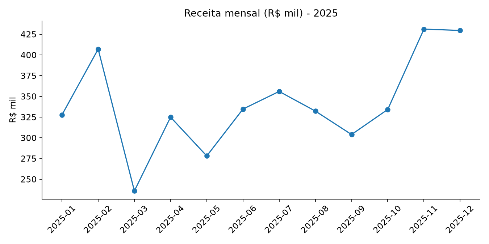

# Daniel Fernando Martins

### Analista de Dados | Negócios + Dados | Power BI · SQL · Python

**24 anos de mercado financeiro** transformando números de carteira em decisão comercial.
Agora, usando dados para fazer isso em escala.

---

## ⭐ Projeto em destaque

**[📊 Análise de Vendas 2025 (Python + SQL)](./analise-vendas)**: limpeza de dados, consultas SQL, gráficos e recomendações de negócio. Receita de R$ 4,1 mi analisada por mês, região, produto e canal (dados sintéticos).

---

## 👋 Quem sou

Analista de Dados com uma combinação pouco comum: **vivência real de negócio** (Bradesco e Cielo) e **formação técnica em dados e sistemas**. Conheço o outro lado da planilha: sei quais perguntas o gestor comercial precisa responder, quais indicadores movem meta e como transformar uma análise em ação.

- 📊 Foco em **análise de dados, BI e automação**, aplicados a negócios e finanças
- 🎓 Cursando **Análise e Desenvolvimento de Sistemas** (Universidade São Judas) e formado em **Economia, Finanças, Gestão de Riscos e Compliance e Direito**
- 🤖 Estudando **IA aplicada a dados**, com certificação **Microsoft Azure AI Fundamentals (AI-900)** e preparação para a AI-901
- 🗣️ Inglês avançado

## 🧰 Stack

| Área | Ferramentas |
|---|---|
| Análise e tratamento de dados | Python, SQL, Excel avançado |
| Bancos de dados | MySQL, PostgreSQL |
| Visualização e BI | Power BI (modelagem, DAX e dashboards) |
| Automação | Power Automate (RPA) |
| IA e nuvem | Azure AI Fundamentals (AI-900) |

## 📈 Por que negócio + dados faz diferença

Resultados que entreguei ao longo da carreira em gestão de carteiras e metas, e que hoje sei medir, modelar e prever com dados:

| Resultado | Contexto |
|---|---|
| **185%** de atingimento de metas por 5 meses seguidos | Carteira de 750 clientes |
| **+35%** no volume de negócios da carteira em 12 meses | Gerente Exclusive, Bradesco |
| **96-97%** de retenção de clientes estratégicos | Segmentos Prime e Exclusive |
| **118%** de atingimento médio e **-14%** na perda de clientes | Gerente de Negócios, Cielo |
| **214%** da meta em campanha de consórcios | Bradesco |

## 🚀 O que você encontra aqui

Repositórios focados em problemas práticos, com README explicando o problema, os dados, o método e as conclusões:

- 🧹 Limpeza, tratamento e modelagem de dados (ETL)
- 🔎 Consultas SQL aplicadas a cenários reais
- 📊 Análise exploratória e dashboards em Power BI

### 🗺️ Próximos projetos (em construção)

- [ ] Análise de **churn e retenção de clientes** (dados públicos de varejo bancário)
- [ ] Dashboard de **performance comercial** (meta x realizado, funil e ticket médio)
- [ ] **Segmentação de clientes** (RFM) com Python
- [ ] Análise de **crédito e inadimplência** com SQL

## 🎓 Formação e certificações

- Análise e Desenvolvimento de Sistemas, Universidade São Judas (em andamento)
- Microsoft Azure AI Fundamentals (AI-900)
- Power BI, análise de dados e data science (Senai)
- Modelagem e Visualização de Dados com Power BI e Excel Avançado
- Power Automate / RPA (DIO)
- ANBIMA CEA, CPA-20 e CPA-10

## 📫 Vamos conversar

Aberto a oportunidades em **Análise de Dados, BI e áreas que unam negócio e dados**.

- 💼 [LinkedIn](https://www.linkedin.com/in/danielfernandomartins)
- ✉️ [dfm21031983@gmail.com](mailto:dfm21031983@gmail.com)
