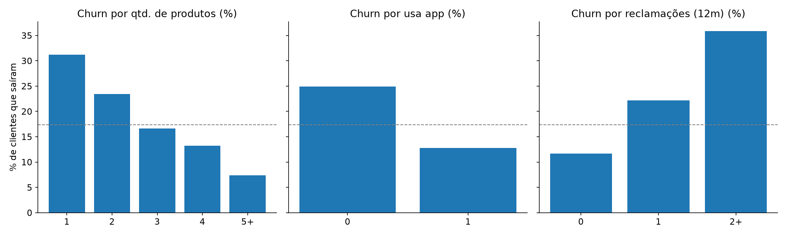

# 🔁 Análise de Churn de Clientes (Python)

**Quais clientes de um banco tendem a sair e o que eles têm em comum?** O resultado vira uma regra simples e explicável de priorização, para a área comercial agir antes da perda.

> ⚠️ **Os dados são sintéticos (fictícios)**, gerados por `gerar_dados.py` com seed fixa. Servem para demonstrar o método e não representam nenhuma instituição real.

## 🎯 Resumo executivo

- **Churn geral:** 17,3% dos 3.000 clientes — a linha de base para qualquer ação.
- **Vínculo protege:** clientes com 1 produto saem **31,2%**; com 5 ou mais, **7,4%**.
- **Digital retém:** quem não usa o app sai **24,9%**, contra **12,8%** de quem usa.
- **Reclamação é alerta:** sem reclamações, **11,7%**; com 2 ou mais, **35,9%**.
- **Tempo de casa:** até 1 ano, **28,0%**; mais de 7 anos, **13,2%**.
- **Segmento** tem efeito pequeno (Varejo 18,5%, Prime 15,2%, Exclusive 15,7%): o problema não é "cliente de segmento X", é comportamento.
- **Score de priorização (0 a 3 pontos):** 0 ponto → **5,5%** de churn; 1 → 13,9%; 2 → 26,7%; 3 → **52,8%**. Uma regra de três linhas separa um grupo com 10x o risco do outro — é isso que a área comercial recebe, não um modelo caixa-preta.

**Recomendação:** priorizar contato nos clientes com 2+ pontos (poucos produtos, sem app e com reclamação), começando pelos de maior saldo. Para cada 100 clientes nesse grupo, ~53 sairiam sem ação.

## 🧮 Score de risco (regra simples)

1 ponto para cada condição: **até 2 produtos**, **não usa app**, **teve reclamação**.

| Pontos | Clientes | Churn |
|---|---|---|
| 0 | 709 | 5,5% |
| 1 | 1.352 | 13,9% |
| 2 | 776 | 26,7% |
| 3 | 163 | **52,8%** |

Os clientes com 2 ou 3 pontos (939 de 3.000) são a lista de contato prioritária.

## 💡 Recomendações (exemplo)

- Ligar primeiro para quem tem 2-3 pontos de risco, tratando a reclamação em aberto.
- Estimular a adesão ao app e a contratação de um segundo ou terceiro produto.
- Acompanhar de perto o primeiro ano de relacionamento.

> Observação metodológica: é uma análise **descritiva**. As associações mostram padrões, não provam causa. Um próximo passo seria um modelo preditivo (regressão logística) validado em base de teste.

## ▶️ Como executar

```bash
pip install -r requirements.txt
python gerar_dados.py   # gera dados/clientes.csv
python analise.py       # tabelas no terminal e gráficos em graficos/
```



---
Feito por **Daniel Fernando Martins** · [LinkedIn](https://www.linkedin.com/in/danielfernandomartins)
## 🧠 Método

1. `gerar_dados.py` cria a base sintética com seed fixa (3.000 clientes, 17,3% de churn).
2. `analise.py` calcula o churn geral e corta por segmento, faixa de produtos, uso do app, reclamações e tempo de casa.
3. Uma regra simples e explicável (0 a 3 pontos) monta a lista de prioridade comercial.
4. Gráficos comparam cada fator com a média geral, e a base priorizada é gravada em `dados/clientes_com_risco.csv`.

## 🧰 Ferramentas

Python (pandas, matplotlib) · Git/GitHub

## 📁 Estrutura

```
analise-churn-clientes/
├── gerar_dados.py        # base sintética (seed fixa)
├── analise.py            # análise + score de risco + gráficos
├── dados/
│   ├── clientes.csv
│   └── clientes_com_risco.csv
└── graficos/
    ├── churn_por_fator.png
    └── churn_por_score.png
```

## ▶️ Como rodar

```bash
pip install -r requirements.txt
python gerar_dados.py
python analise.py
```

## ⚠️ Sobre os dados

Dados **sintéticos** (fictícios), gerados por script com seed fixa. Não representam nenhuma instituição real.

## 🚀 Próximos passos

- [ ] Modelo de propensão (regressão logística) comparado ao score de regras, com curva ROC
- [ ] Análise de coorte e LTV no mesmo estilo (ver [`analise-cohort-retencao`](../analise-cohort-retencao))

