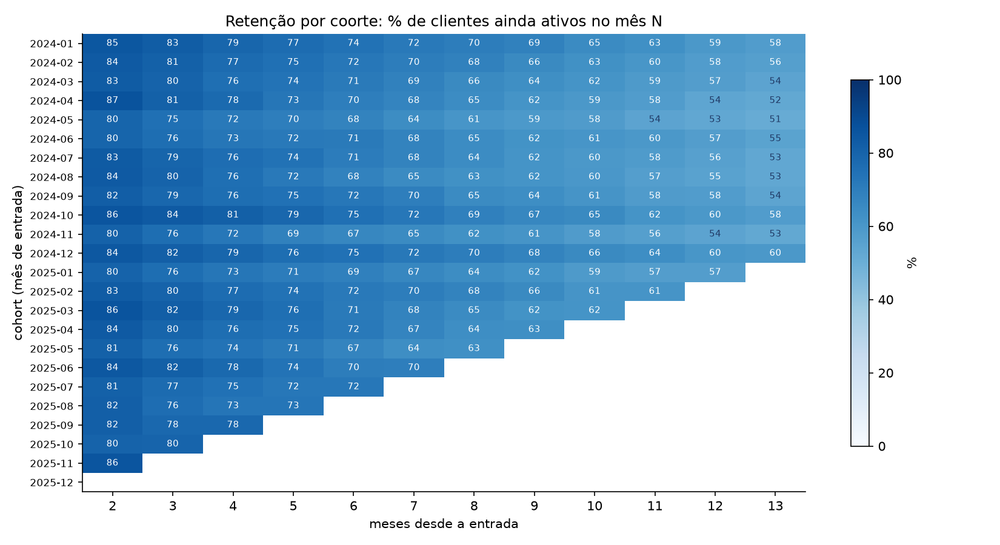

# 🔄 Retenção de Assinantes: análise de coorte, churn e LTV

> **Pergunta de negócio:** *quanto tempo os clientes ficam, quais entram e já saem, e onde vale investir para adquirir cliente?*



## 🎯 Resumo executivo

| Indicador | Resultado |
|---|---|
| 👥 Assinantes na base | 7.613 (4.580 ativos em 31/12/2025) |
| 📉 Retenção no 1º mês | **88,1%** |
| 📆 Retenção no 3º mês | **79,2%** |
| 📆 Retenção no 6º mês | **71,0%** |
| 📆 Retenção no 12º mês | **56,8%** |
| ⏳ Vida média | 7,1 meses (Básico) · 8,3 (Pro) · **9,0 (Premium)** |
| 💰 LTV estimado | R$ 251 (Básico via Pago) até **R$ 1.439** (Premium via Parceria) |

**Três leituras que um gestor usa na segunda-feira:**

1. **As taxas diferem por plano nesta base sintética.** O Premium fica 27% mais tempo que o Básico (9,0 vs 7,1 meses). O Básico é porta de entrada, não produto de retenção: precisa de um caminho de *upgrade* nos primeiros 90 dias, quando o churn é mais forte.
2. **Clientes do canal Pago apresentam menor vida média nesta simulação** (7,3 meses, contra 8,5 de Indicação). O LTV do Básico vindo do canal Pago (R$ 251) é o pior da carteira: se o CAC passar disso, a aquisição destrói valor.
3. **O risco se concentra no começo.** A curva cai de 100% para 79% em três meses e depois desacelera. A curva sugere investigar onboarding nas primeiras 12 semanas; o projeto não testa causalmente o efeito dessa intervenção.

## 🧠 Método

1. **Base sintética reproduzível** (`gerar_dados.py`, seed fixa): cada assinante tem plano, canal de aquisição, UF, data de entrada e data de saída — com risco de churn dependente de plano, canal e tempo de casa, para que exista um padrão real a ser descoberto.
2. **SQL analítico** (`analise.py`, SQLite): uma CTE calcula a vida de cada cliente em dias desde o 1º dia do mês de entrada e uma grade cliente × mês mantém apenas os meses que o cliente já teve tempo de completar. Isso evita o viés clássico de a retenção "subir" nas coortes recentes.
3. **Matriz de retenção** (cohort × mês) em CSV e heatmap — o formato que se pede em entrevista.
4. **Recorte por plano e por canal**, com vida média em meses e uma aproximação de churn mensal (`1 ÷ vida média`), que não equivale a uma taxa de sobrevivência estimada por Kaplan–Meier.
5. **LTV simplificado** = mensalidade média × vida média observada, por plano × canal (mínimo de 100 clientes). Não desconta margem, CAC, churn censurado ou valor do dinheiro no tempo.

## 📁 Estrutura

```
analise-cohort-retencao/
├── gerar_dados.py              # cria dados/assinantes.csv (dados fictícios)
├── analise.py                  # SQL + matriz de coorte + LTV + gráficos
├── dados/
│   ├── assinantes.csv
│   ├── cohort_retencao.csv     # matriz cohort x mês (%)
│   ├── cohort_tamanho.csv
│   ├── retencao_por_plano.csv
│   ├── retencao_por_canal.csv
│   └── resumo_ltv.csv
└── graficos/
    ├── cohort_retencao.png
    ├── curva_retencao.png
    └── vida_media_canal.png
```

## ▶️ Como rodar

```bash
pip install -r requirements.txt
python gerar_dados.py   # recria a base sintética (opcional)
python analise.py       # gera as tabelas e os gráficos
```

## ⚠️ Sobre os dados

Todos os dados são **sintéticos** (fictícios), gerados por script com seed fixa, para demonstrar o método. Nenhuma informação de empresa real foi usada.

## 🚀 Próximos passos

- [ ] Modelo de propensão a churn (regressão logística) com curva ROC e ganho acumulado
- [ ] Teste A/B do fluxo de *onboarding* medindo a retenção no mês 3 (ver projeto [`analise-teste-ab`](../analise-teste-ab))
- [ ] Publicar o heatmap de coorte em um dashboard (Power BI / Tableau)
