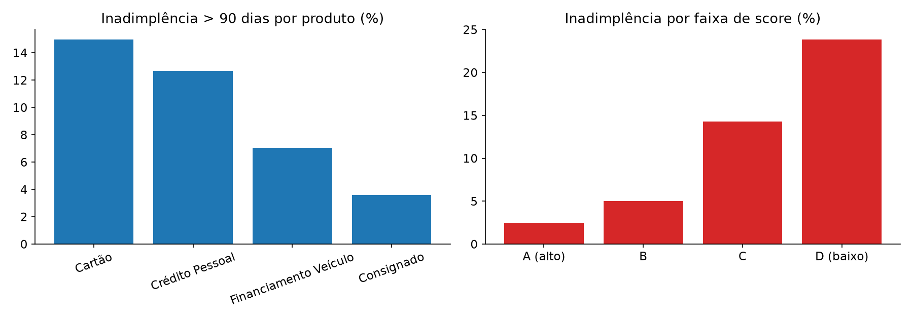

# 🏦 Análise de Inadimplência de Crédito (SQL)

Projeto focado em **SQL analítico**: seis consultas sobre uma carteira de crédito, usando `GROUP BY`, CTEs, funções de janela (`AVG OVER`, `RANK`, `NTILE`) e subqueries. Um script em Python executa as consultas e gera os gráficos.

> ⚠️ **Os dados são sintéticos (fictícios)**, gerados por `gerar_dados.py` com seed fixa. Não representam nenhuma instituição real.

**Definição usada:** inadimplente = contrato com mais de 90 dias de atraso.



## 🎯 Resumo executivo

- **Carteira:** 4.000 contratos, R$ 64,0 milhões; inadimplência de **9,15%** dos contratos e **8,09%** do valor.
- **Por produto:** Cartão **14,96%** e Crédito Pessoal **12,69%**; Consignado só **3,60%**.
- **Por score:** faixa D com **23,82%** contra **2,48%** da faixa A.
- **Safras:** a média móvel de 3 meses oscila entre 8,7% e 9,5%, sem tendência clara.
- **Concentração:** os 10% maiores contratos inadimplentes (37 contratos) respondem por **46,8%** do valor inadimplente.

**Recomendação (o que eu levaria para a mesa de crédito):**

- Reforçar a política de crédito para **Cartão e Crédito Pessoal nas faixas C e D** — ali está o volume da perda.
- Tratar os **contratos de maior valor** de forma individual: quase metade da perda está em 37 contratos.
- Manter o acompanhamento mensal por **safra com média móvel**, que é o indicador que antecipa deterioração.

## 🎯 Perguntas respondidas

1. Qual o tamanho da carteira e a inadimplência (em contratos e em valor)?
2. Quais produtos e faixas de score concentram o risco?
3. A inadimplência por safra está estável?
4. Onde está concentrado o valor inadimplente?

## 🧠 Método

1. `gerar_dados.py` cria a carteira de crédito sintética em `dados/credito.db` (SQLite).
2. `consultas.sql` traz 6 consultas comentadas: visão geral, produto, faixa de score, safra com média móvel, ranking por produto/score e concentração.
3. `analise.py` executa cada consulta, grava o resultado em CSV e gera os gráficos.

## 🧰 Técnicas de SQL praticadas

| Consulta | Técnica |
|---|---|
| 1, 2, 3 | Agregações, `GROUP BY`, `CASE WHEN` |
| 4 | CTE + média móvel com `AVG() OVER (... ROWS BETWEEN ...)` |
| 5 | `RANK() OVER (PARTITION BY ...)` |
| 6 | CTE + `NTILE` + subquery |

## 📁 Estrutura

```
analise-inadimplencia-sql/
├── gerar_dados.py            # cria dados/credito.db
├── consultas.sql             # 6 consultas comentadas
├── analise.py                # executa as consultas e gera os gráficos
├── dados/
│   ├── credito.db
│   ├── emprestimos.csv
│   └── resultado_*.csv       # um CSV por consulta
└── graficos/
    ├── inadimplencia_produto_score.png
    └── inadimplencia_safra.png
```

## ▶️ Como rodar

```bash
pip install -r requirements.txt
python gerar_dados.py   # cria dados/credito.db
python analise.py       # roda consultas.sql e gera os gráficos
```

## 🚀 Próximos passos

- [ ] Versão das consultas em PostgreSQL (window functions + `date_trunc`)
- [ ] Provisionamento (IFRS 9 simplificado) por faixa de atraso
- [ ] Painel de acompanhamento mensal de safra no Power BI

---
Feito por **Daniel Fernando Martins** · [LinkedIn](https://www.linkedin.com/in/danielfernandomartins)
