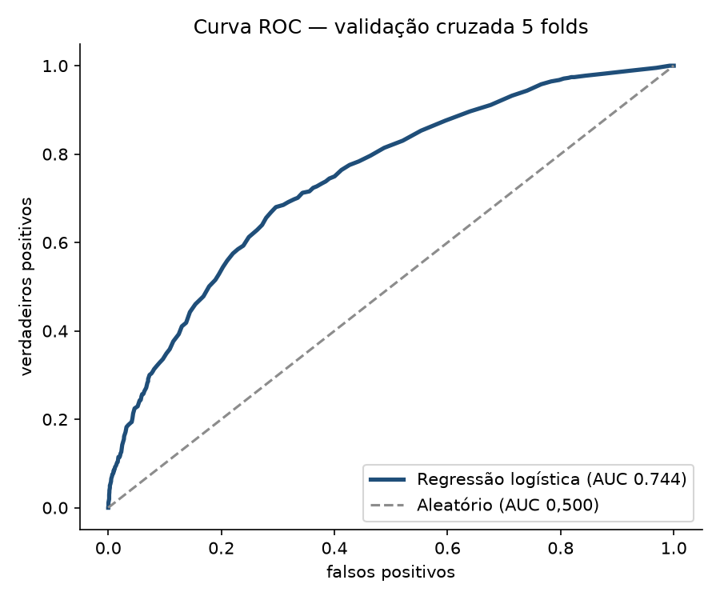

# 🧮 Score de Risco de Churn: da regra de negócio ao modelo com AUC

> **Pergunta de negócio:** *para quem a equipe deve ligar primeiro? A regra simples que o comercial já usa é boa o suficiente, ou um modelo entrega mais?*



## 🎯 Resumo executivo

| Modelo | AUC | KS | Precisão (top 20%) | Recall (top 20%) | F1 |
|---|---|---|---|---|---|
| Score de regras (0 a 3 pontos) | 0,714 | 0,350 | 0,344 | **0,690** | **0,459** |
| **Regressão logística (5 variáveis)** | **0,744** | **0,387** | **0,437** | 0,423 | 0,430 |

- **O modelo ordena melhor** (AUC 0,744 vs 0,714 e KS 0,387 vs 0,350) e, no mesmo esforço de 20% da base, acerta **44% dos contatos** contra 34% da regra.
- **A regra ainda tem valor**: com o corte em 2 pontos ela liga para 1.240 clientes e captura 427 churns — mais churn em número absoluto, gastando o dobro de ligações. A escolha é de **custo por contato**, não de estatística.
- **Faixas de risco do modelo:** baixo **5,2%** de churn, moderado 13,4%, alto 28,5%, muito alto 43,7% e crítico **59,0%** — o dobro de separação entre a primeira e a última faixa.
- **Associações estimadas pelo modelo** (odds ratio; não implicam causalidade): não usar o app **1,76×**, reclamação no ano **1,56×**, ter 1–2 produtos **1,55×**, ser cliente novo **1,25×**; saldo alto **reduz** o risco (0,86×).

**Recomendação didática:** comparar a ordenação do modelo e a regra simples. Como os dados são sintéticos, os resultados não justificam uso operacional nem contato real com clientes. Ligando para os 20% de maior risco, 4 em cada 10 contatos estão realmente em risco — 27% melhor que a regra atual.

## 🧠 Método

1. **Base sintética reproduzível** (`gerar_dados.py`): 3.000 clientes, churn de 20,6%, com efeito real embutido em produtos, app, reclamações, tempo de casa e saldo.
2. **Regressão logística implementada do zero** (gradiente descendente + regularização L2). A padronização é ajustada dentro de cada fold para evitar vazamento de informação — sem `sklearn`.
3. **Validação cruzada estratificada em 5 folds**: as probabilidades que aparecem nas métricas são de clientes fora do fold de treino. O modelo final é ajustado separadamente para produzir coeficientes.
4. **Métricas de classificação**: AUC (Mann-Whitney, com empates), **KS** (a métrica que o mercado de crédito usa), precisão, recall, F1 e acurácia no corte de 20% da base.
5. **Curva de ganho acumulado**: quantos churns a equipe captura contatando 10%, 20%, 30%… da base — a métrica que o gestor entende.
6. **Explicabilidade**: coeficientes convertidos em odds ratio, e faixas de risco com o churn observado em cada uma.

## 📁 Estrutura

```
analise-risco-credito/
├── gerar_dados.py               # base sintética (seed fixa)
├── analise.py                   # modelo, validação cruzada, métricas e gráficos
├── dados/
│   ├── clientes.csv
│   ├── base_com_score.csv       # 1 linha por cliente, com probabilidade e faixa
│   ├── comparacao_modelos.csv
│   ├── coeficientes.csv
│   └── ganho_acumulado.csv
└── graficos/
    ├── curva_roc.png
    ├── ganho_acumulado.png
    └── churn_por_score.png
```

## ▶️ Como rodar

```bash
pip install -r requirements.txt
python gerar_dados.py
python analise.py
```

## ⚠️ Sobre os dados

Dados **sintéticos** (fictícios), gerados por script com seed fixa. Não representam nenhuma instituição real e o modelo não deve ser usado com dados de pessoas reais sem avaliação de viés e conformidade com a LGPD.

## 🚀 Próximos passos

- [ ] Comparar com árvore de decisão e Random Forest (com a mesma validação)
- [ ] Avaliar **lift por decis** e definir o corte pelo custo da ligação vs. valor do cliente retido
- [ ] Checar viés entre segmentos (paridade de recall por segmento)
