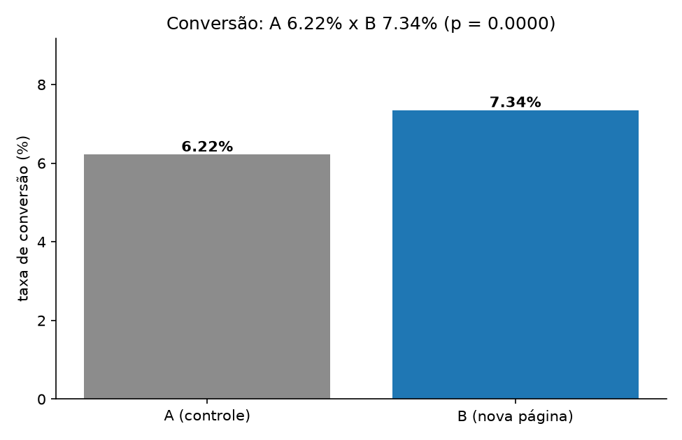

# 🧪 Teste A/B de Conversão: o ganho é real ou sorte?

> **Pergunta de negócio:** *a nova página de checkout converte mais de verdade? Podemos publicar com segurança?*



## 🎯 Resumo executivo

| Métrica | Controle (A) | Variante (B) | Diferença |
|---|---|---|---|
| Visitantes | 22.663 | 23.772 | — |
| Pedidos | 1.409 | 1.746 | +337 |
| **Conversão** | **6,22%** | **7,34%** | **+1,13 p.p. (+18,1%)** |
| Receita por visitante | R$ 12,75 | R$ 15,07 | +18,2% |
| p-valor (teste z bilateral) | — | — | **p < 0,0001** |
| IC 95% do ganho | — | — | **[+0,67; +1,58] p.p.** |

**Decisão recomendada: publicar a variante B.**

- O ganho é **estatisticamente significativo** (p < 0,0001, muito abaixo de 0,05) e o intervalo de confiança de 95% não toca o zero: o ganho mínimo plausível ainda é +0,67 p.p.
- Com ~807 mil visitantes/ano, o ganho projetado é de **+R$ 1,86 milhão de receita por ano**.
- O teste já tinha amostra suficiente: para detectar um efeito desse tamanho com 80% de poder, eram necessários ~7.805 visitantes por grupo — o experimento teve mais de 22 mil.
- A conversão acumulada estabiliza no meio do experimento (gráfico 3), sinal de que **não houve novidade passageira** nem vazamento entre grupos.

## 🧠 Método

1. **Base sintética** (`gerar_dados.py`): 21 dias, ~2.200 visitantes/dia divididos entre A e B, com um efeito real embutido (+1,4 p.p. de conversão) para o teste ter o que encontrar.
2. **Métrica primária:** conversão (pedidos ÷ visitantes). Métricas secundárias: ticket médio e receita por visitante (para garantir que a variante não ganha convertendo pedidos piores).
3. **Teste z para duas proporções** (bilateral, α = 0,05), com erro padrão agrupado — o teste padrão de mercado para conversão.
4. **Intervalo de confiança de 95%** para o lift absoluto, sem agrupamento.
5. **Poder estatístico:** cálculo do tamanho de amostra necessário com poder de 80%.
6. **Impacto financeiro:** ganho de receita por visitante extrapolado para o volume anual.

## 📁 Estrutura

```
analise-teste-ab/
├── gerar_dados.py
├── analise.py
├── dados/
│   ├── experimento.csv
│   ├── resumo_por_grupo.csv
│   └── resultado_teste.csv
└── graficos/
    ├── conversao_por_grupo.png
    ├── conversao_diaria.png
    └── ganho_acumulado.png
```

## ▶️ Como rodar

```bash
pip install -r requirements.txt
python gerar_dados.py
python analise.py
```

## ⚠️ Sobre os dados

Dados **sintéticos** (fictícios), gerados por script com seed fixa. Nenhuma empresa real foi usada. O objetivo é demonstrar o método de análise de experimentos, não um resultado comercial verdadeiro.

## 🚀 Próximos passos

- [ ] Teste de proporção para o ticket médio (teste t de Welch) para checar efeito na receita
- [ ] Segmentação do efeito por dispositivo (mobile x desktop)
- [ ] Cálculo de *sequential testing* (olhar os dados todo dia sem inflar o erro tipo I)
