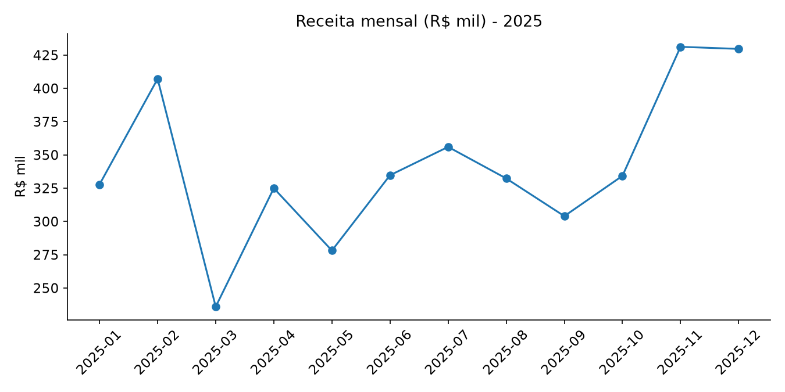

# 📊 Análise de Vendas 2025 — do CSV bruto à recomendação comercial

> **Pergunta de negócio:** *onde a receita está crescendo, qual região e produto sustentam o resultado e o que fazer com os 10% de pedidos sem região?*



## 🎯 Resumo executivo

| Indicador | Resultado |
|---|---|
| Pedidos analisados | 2.119 (após remover duplicatas) |
| Receita total | R$ 4,10 milhões |
| Ticket médio | R$ 1.932 |
| Maior canal | Online (R$ 1,78 mi, 1.049 pedidos) |
| Maior ticket | Televendas (R$ 2.180 por pedido) |
| Maior região | Sudeste (36,1% da receita) |
| Dado ausente tratado | 25 pedidos sem região → "Não informada" (mantidos, não descartados) |

**Três leituras para a reunião comercial:**

1. **Canal define o ticket.** O Online vende mais (1.049 pedidos) mas com o menor ticket (R$ 1.696); Televendas e Loja física vendem menos e com ticket 27% maior. Ou seja: o digital traz volume, o atendimento humano traz valor — os dois precisam de metas diferentes.
2. **A receita é pulverizada, mas o Sudeste lidera.** Sudeste (36,1%), Nordeste (22,8%) e Sul (20,6%) formam 80% da receita; Norte tem só 5,6% com o mesmo esforço comercial. O Norte tem o menor ticket (R$ 1.653) e o Centro-Oeste, poucos pedidos (258) mas ticket alto (R$ 2.193): ali o ganho está em aumentar volume, não em mudar o preço.
3. **Qualidade de dado é decisão de negócio.** Em vez de excluir os 25 pedidos sem região, o tratamento preservou o faturamento e isolou o problema numa categoria explícita ("Não informada") — decisão documentada no código, do tipo que se explica em entrevista.

## 🧠 Método

1. **Limpeza auditável**: remove duplicatas por `id_pedido`, trata região vazia como "Não informada" e recalcula `receita = quantidade × preço unitário`.
2. **Análise em SQL** (SQLite, na memória): receita por mês, por região (com participação %), por produto e por canal, usando `GROUP BY` e subquery de total.
3. **Análise de sazonalidade** na série mensal e **gráficos** comparando as dimensões.
4. **Recomendações** escritas a partir dos números, não de opinião.

## 📁 Estrutura

```
analise-vendas/
├── gerar_dados.py        # cria dados/vendas_bruto.csv (dados fictícios, com erros)
├── analise.py            # limpeza + SQL + gráficos
├── consultas.sql         # as mesmas consultas, para consulta rápida
├── dados/
│   ├── vendas_bruto.csv  # entrada "suja"
│   └── vendas_limpo.csv  # saída tratada
└── graficos/
    ├── receita_mensal.png
    ├── receita_produto.png
    └── receita_regiao.png
```

## ▶️ Como rodar

```bash
pip install -r requirements.txt
python gerar_dados.py
python analise.py
```

## ⚠️ Sobre os dados

Dados **sintéticos** (fictícios), gerados por script com seed fixa, incluindo duplicatas e campos vazios de propósito. Nenhuma empresa real foi usada.

## 🚀 Próximos passos

- [ ] Teste A/B de campanha por canal (ver [`analise-teste-ab`](../analise-teste-ab))
- [ ] Previsão de receita mensal com intervalo de confiança (ver [`previsao-demanda`](../previsao-demanda))
- [ ] Painel de acompanhamento no Power BI
