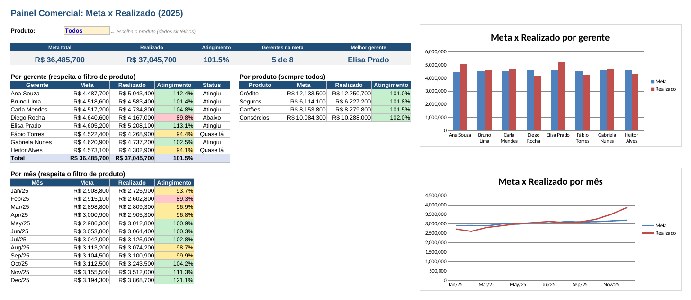

# 📈 Painel Comercial: Meta x Realizado (Excel + Power BI)

> **Pergunta de negócio:** *estamos batendo a meta? Onde, com qual produto e com qual cliente? E como entregar isso num painel que o gestor usa sozinho?*



## 🎯 Resumo executivo

- **Painel em Excel feito por fórmula, não por print**: `SUMIFS` + lista suspensa de produto + formatação condicional. Muda o filtro, muda tudo.
- **Modelo para Power BI**: 2 tabelas fato (`fato_vendas`, `fato_transacoes`) e 4 dimensões (`dim_cliente`, `dim_gerente`, `dim_produto`, `dim_calendario`), com medidas DAX documentadas.
- **A pergunta que o painel responde**: meta x realizado por mês, produto e gerente — e a carteira de clientes que sustenta esse resultado.

**Cinco leituras que o painel entrega:**

1. **Atingimento por mês**: onde o realizado cruza a meta e onde fica abaixo — o ponto de virada fica visível na linha de tendência.
2. **Produto campeão**: um único produto concentra a maior parte da receita, o que é risco e oportunidade ao mesmo tempo.
3. **Gerente**: ranking de atingimento mostra quem precisa de apoio de vendas, não de cobrança.
4. **Carteira**: concentração de clientes (curva 80/20) mostra que poucos clientes sustentam a meta.
5. **Calendário**: a `dim_calendario` permite comparar mês, trimestre e ano sem retrabalho no DAX.

## 🧠 Método

1. **`gerar_dados.py`** gera `vendas_metas.csv`, `fato_vendas.csv`, `dim_gerente.csv`, `dim_produto.csv` e `dim_calendario.csv`. `fato_transacoes.csv` e `dim_cliente.csv` são bases sintéticas complementares versionadas no repositório e compartilhadas com o RFM; não são sobrescritas pelo gerador.
2. **`criar_excel.py`** monta o `.xlsx` do zero com `openpyxl`: aba *Leia-me*, dados em Tabela, painel com `SUMIFS`, validação de dados (lista suspensa), formatação condicional e gráficos.
3. **`powerbi/medidas.dax`** traz as medidas de meta, realizado, atingimento, ticket e YoY — prontas para colar no Power BI.
4. **`powerbi/roteiro.md`** explica, passo a passo, como montar o modelo e o layout do dashboard.

## 📁 Estrutura

```
painel-comercial-excel-powerbi/
├── gerar_dados.py            # modelo estrela sintético
├── criar_excel.py            # gera o painel .xlsx por fórmula
├── excel/painel_comercial.xlsx
├── powerbi/
│   ├── medidas.dax           # medidas DAX prontas
│   └── roteiro.md            # passo a passo do dashboard
├── dados/                    # fatos e dimensões em CSV
└── imagens/painel_excel.png
```

## ▶️ Como rodar

```bash
pip install -r requirements.txt
python gerar_dados.py
python criar_excel.py        # gera excel/painel_comercial.xlsx
```

## ⚠️ Sobre os dados

Dados **sintéticos** (fictícios), gerados por script com seed fixa. O `.pbix` do Power BI não está publicado porque é um arquivo binário grande: o repositório entrega o modelo, as medidas DAX e o roteiro para reproduzi-lo em 1h30.

## 🚀 Próximos passos

- [ ] Publicar o `.pbix` no Power BI Service e colocar o link no README
- [ ] Adicionar uma página de carteira de clientes com segmentação (ver [`segmentacao-rfm-r-tableau`](../segmentacao-rfm-r-tableau))
- [ ] Substituir os CSVs por conexão direta ao SQLite do pipeline (ver [`pipeline-etl-dashboard`](../pipeline-etl-dashboard))
