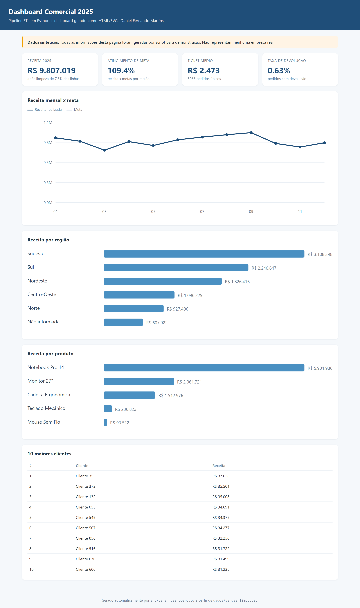

# 🏗️ Pipeline ETL + Dashboard Executivo

> **Pergunta de negócio:** *os números que chegam da operação são confiáveis? E como entregar um painel de gestão que qualquer diretor abre e entende?*



**[▶️ Abrir o dashboard](dashboard.html)** — arquivo único, abre no navegador, funciona offline.

## 🎯 Resumo executivo

| Indicador | Resultado |
|---|---|
| Linhas brutas recebidas | 4.290 |
| Linhas após o pipeline | 3.966 (**7,6% descartadas e justificadas**) |
| Receita 2025 | R$ 9,81 milhões |
| Atingimento de meta | **109,4%** |
| Ticket médio | R$ 2.472,77 |
| Taxa de devolução | 0,63% |
| Clientes com cadastro | 891 |
| Regras de qualidade aprovadas | **7 de 7** |

**O que o pipeline descobriu na base "suja":**

1. **324 linhas sem quantidade ou preço** (7,6% da base) — exportação do ERP com campos vazios. Sem tratamento, a receita seria subestimada.
2. **84 pedidos duplicados** (a exportação rodou duas vezes): sem deduplicar, a receita inflaria ~2%.
3. **25 devoluções lançadas como quantidade negativa** — são identificadas e tratadas como estorno integral do valor bruto na receita líquida (hipótese explícita desta simulação).
4. **8 grafias para 5 produtos** (`NOTEBOOK PRO 14`, `notebook pro 14`, …): o ranking de produto ficava fragmentado.
5. **Datas em dois formatos** (`2025-03-14` e `14/03/2025`) na mesma coluna.
6. **40 clientes duplicados** no cadastro e 6% de e-mails inválidos.

**Leitura de negócio:** o Sudeste concentra a receita (R$ 3,1 mi) e bate a meta com folga, enquanto Norte e Centro-Oeste ficam abaixo do plano — o problema é de cobertura comercial, não de demanda. O **Notebook Pro 14 responde por 60% da receita**: uma dependência de produto que o gestor precisa saber.

## 🧠 Método

```
dados/vendas_2025.csv ─┐
dados/clientes.csv ────┼─► src/etl.py ─► dados/vendas_limpo.csv ─► src/kpis.sql (SQLite)
dados/metas.csv ───────┘        │                                   └─► src/gerar_dashboard.py ─► dashboard.html
                                └─► dados/qualidade.csv + log_etl.json
```

1. **EXTRACT**: três fontes independentes (ERP, cadastro, metas).
2. **TRANSFORM**: datas, números, devoluções, duplicatas, de-para de produto, deduplicação de cliente, cruzamentos e receita.
3. **VALIDATE**: 7 regras de negócio (chave única, valores positivos, período, integridade com metas) — o pipeline **falha alto** se uma regra quebrar.
4. **LOAD**: base limpa em CSV + SQLite, KPIs, log auditável de cada transformação e dashboard HTML.
5. **SQL analítico** (`src/kpis.sql`): receita por mês, atingimento por região com CTE, ranking de produto com `RANK() OVER`, curva 80/20 de cliente, devoluções e tabela dinâmica por canal.

## 📁 Estrutura

```
pipeline-etl-dashboard/
├── dashboard.html              # painel final (abre no navegador, offline)
├── src/
│   ├── gerar_fontes.py         # cria as 3 fontes "sujas"
│   ├── etl.py                  # pipeline com log e regras de qualidade
│   ├── gerar_dashboard.py      # gera o HTML/SVG a partir da base limpa
│   └── kpis.sql                # 6 consultas de negócio
└── dados/
    ├── vendas_2025.csv         # fonte bruta (suja)
    ├── vendas_limpo.csv        # saída do pipeline
    ├── qualidade.csv           # regras de qualidade e resultado
    ├── kpis.csv
    ├── log_etl.json            # auditoria de cada transformação
    └── comercial.db            # SQLite com a tabela tratada
```

## ▶️ Como rodar

```bash
pip install -r requirements.txt
python src/gerar_fontes.py      # recria as fontes sintéticas (opcional)
python src/etl.py               # roda o pipeline e imprime o log
python src/gerar_dashboard.py   # gera dashboard.html
sqlite3 dados/comercial.db < src/kpis.sql   # opcional: consultas de negócio
```

## ⚠️ Sobre os dados

Dados **sintéticos** (fictícios), gerados por script com seed fixa, incluindo erros de propósito para demonstrar o tratamento. Nenhuma empresa real foi usada.

## 🚀 Próximos passos

- [x] Executar ETL, regras de qualidade e geração do dashboard nos testes do GitHub Actions
- [ ] Publicar o dashboard gerado como artefato do workflow ou GitHub Pages
- [ ] Testes de contrato isolados para cada regra de qualidade
- [ ] Versão do painel em Power BI conectada ao SQLite
