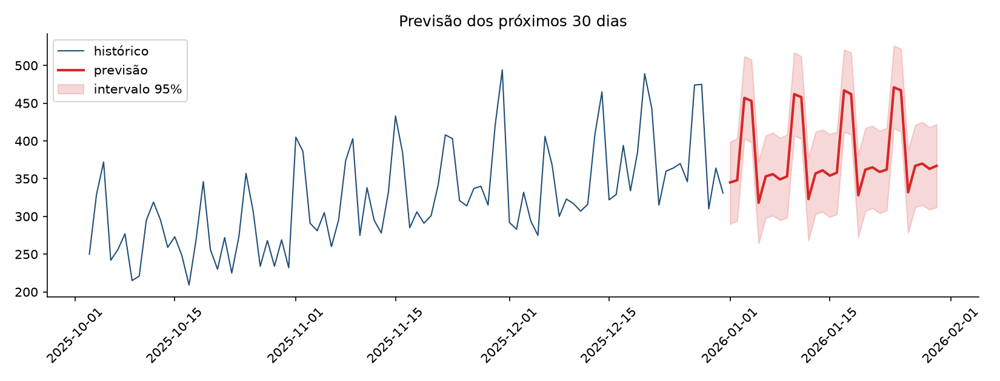

# 🚀 Previsão de Demanda: série temporal com validação honesta

> **Pergunta de negócio:** *quantos pedidos vou receber nos próximos 30 dias? Com que margem de erro?*



## 🎯 Resumo executivo

| Modelo | MAE | RMSE | MAPE | WAPE |
|---|---|---|---|---|
| Baseline sazonal (média do mesmo dia da semana, 8 semanas) | **55,8 pedidos** | **64,5** | **14,9%** | **15,6%** |
| Holt-Winters (tendência + sazonalidade semanal) | 67,0 pedidos | 71,9 | 19,9% | 18,7% |

**Leitura honesta:** neste histórico de 2 anos, o **baseline sazonal venceu** o modelo mais sofisticado. Esse é o resultado observado na base sintética. Não representa desempenho em operação real. O Holt-Winters ainda não capturou o crescimento recente, então o baseline é o modelo escolhido para a operação.

- Previsão dos próximos 30 dias: **~11.400 pedidos**, com uma faixa empírica aproximada baseada na dispersão recente dos resíduos; não é um intervalo preditivo calibrado.
- A série tem **sazonalidade semanal forte** (sábado e domingo ~28% acima dos dias úteis) e **pico de fim de ano** — o planejamento de estoque e de escala deve seguir esse calendário, não a média do mês.
- O erro médio de 15,6% (WAPE) é adequado para planejamento de curto prazo; para compras de longo prazo, o próximo passo é testar Prophet/SARIMA com efeito de feriado.

## 🧠 Método

1. **Dados sintéticos reproduzíveis** (`gerar_dados.py`, seed fixa): 731 dias com tendência, sazonalidade semanal e anual e ruído.
2. **Dois modelos implementados do zero**, sem caixa-preta: baseline sazonal e Holt-Winters aditivo (7 dias).
3. **Validação temporal** (nunca aleatória em série temporal): treino até 30/11/2025, teste em dezembro/2025.
4. **Parâmetros do Holt-Winters escolhidos por busca em grade** apenas na validação interna — o período de teste não é usado para ajustar nada.
5. **Métricas de negócio**: MAE (pedidos), RMSE, MAPE e **WAPE** (a métrica certa quando há dias de baixo volume).
6. **Intervalo de previsão de 95%** calculado a partir do desvio dos resíduos do próprio modelo.

## 📁 Estrutura

```
previsao-demanda/
├── gerar_dados.py
├── previsao.py
├── dados/
│   ├── demanda_diaria.csv
│   ├── metricas_modelos.csv
│   └── previsao_30dias.csv
└── graficos/
    ├── historico.png
    ├── comparacao_modelos.png
    └── previsao_30dias.png
```

## ▶️ Como rodar

```bash
pip install -r requirements.txt
python gerar_dados.py
python previsao.py
```

## ⚠️ Sobre os dados

Dados **sintéticos** (fictícios), gerados por script com seed fixa, para demonstrar o método. Nenhuma empresa real foi usada.

## 🚀 Próximos passos

- [ ] SARIMA / Prophet com feriados nacionais e Black Friday
- [ ] Backtest móvel (rolling origin) em 12 janelas para medir estabilidade
- [ ] Conectar a previsão a um alerta de estoque (ex.: quando a previsão do dia superar o estoque disponível)
