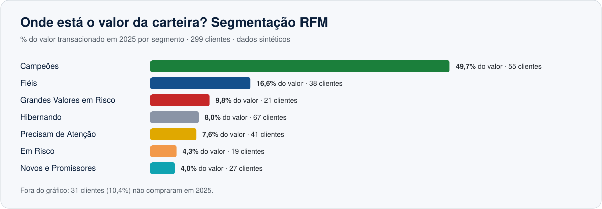

# 🎯 Segmentação de Clientes (RFM) com R + Tableau

Quem são os clientes que mais valem, quais estão esfriando e onde agir primeiro? Este projeto segmenta uma carteira comercial pela técnica **RFM** (Recência, Frequência e Valor) em **R** e prepara a base para o dashboard em **Tableau**.

> ⚠️ **Os dados são sintéticos (fictícios).** As transações vêm do projeto [`painel-comercial-excel-powerbi`](../painel-comercial-excel-powerbi), e a soma por cliente bate com o realizado daquele painel (R$ 37,05 milhões).

**Status:** script em R e bases prontos · versão equivalente em Python (`gerar_rfm.py`) para quem não tem R instalado · dashboard no Tableau Public em construção.



<sub>Prévia montada com os valores de `dados/resumo_segmentos.csv`.</sub>

## 🎯 Resumo executivo

| Segmento | Clientes | % clientes | Valor (R$ mi) | % valor | Recência média |
|---|---:|---:|---:|---:|---:|
| Campeões | 55 | 18,4% | 18,41 | **49,7%** | 12 dias |
| Fiéis | 38 | 12,7% | 6,15 | 16,6% | 42 dias |
| Grandes Valores em Risco | 21 | 7,0% | 3,61 | 9,8% | 119 dias |
| Hibernando | 67 | 22,4% | 2,98 | 8,0% | 188 dias |
| Precisam de Atenção | 41 | 13,7% | 2,83 | 7,6% | 44 dias |
| Em Risco | 19 | 6,4% | 1,58 | 4,3% | 112 dias |
| Novos e Promissores | 27 | 9,0% | 1,48 | 4,0% | 18 dias |
| Sem compras em 2025 | 31 | 10,4% | 0,00 | 0,0% | n/d |

- **Concentração:** Campeões e Fiéis são 31% da carteira e geram **66%** do valor.
- **Risco:** os 21 clientes de *Grandes Valores em Risco* (média de 119 dias sem comprar) somam R$ 3,6 milhões, cerca de 10% do total.
- **Carteira parada:** 31 clientes (10,4%) não compraram nada em 2025 e outros 67 estão hibernando.

## 🎯 Perguntas respondidas

1. Quais clientes sustentam a receita e quais estão sem comprar há muito tempo?
2. Quanto do valor está em clientes em risco de perda e merece ação imediata?
3. Quantos clientes da carteira não compraram nada no ano?
4. Como os segmentos se distribuem por gerente, região e porte?

## 🧰 Ferramentas

**R** (R base, sem pacotes: `tapply`, `merge`, `rank`, exportação em CSV) · **Python** (versão equivalente para validação e para quem não tem R) · **Tableau** (dashboard interativo) · Git/GitHub

## 🧠 Método

| Dimensão | Como medi |
|---|---|
| **R**ecência | Dias entre a última compra e 31/12/2025 (menos dias = melhor) |
| **F**requência | Número de transações no ano |
| **V**alor (M) | Soma do valor transacionado no ano |

Cada dimensão recebe uma nota de **1 a 5** por quintis (empates recebem a mesma nota; na recência a escala é invertida). Depois, regras simples classificam o cliente. **A regra mais abaixo prevalece sobre as de cima:**

| Segmento | Regra |
|---|---|
| Precisam de Atenção | Demais casos |
| Hibernando | R ≤ 2 e F ≤ 2 |
| Novos e Promissores | R ≥ 4 e F ≤ 2 |
| Em Risco | R ≤ 2 e F ≥ 3 |
| Grandes Valores em Risco | R ≤ 2 e M ≥ 4 |
| Fiéis | R ≥ 3 e F ≥ 4 |
| Campeões | R ≥ 4, F ≥ 4 e M ≥ 4 |
| Sem compras em 2025 | Cliente do cadastro sem nenhuma transação |

**Conferência:** o valor total segmentado tem que ser igual ao valor total das transações — checado com `stopifnot` no R, com asserção no Python e por um teste automatizado no CI.

## ▶️ Como rodar

```bash
# a partir da pasta do projeto (precisa só do R instalado)
Rscript analise_rfm.R

# sem R instalado? a versão equivalente em Python grava em dados/python/
python gerar_rfm.py
```

O script em R lê `dados/fato_transacoes.csv` e `dados/dim_cliente.csv`, confere se o valor total segmentado é igual ao das transações e grava `dados/rfm_clientes.csv` e `dados/resumo_segmentos.csv`. Abra o arquivo em UTF-8 (no RStudio: *File → Reopen with Encoding → UTF-8*).

## 📊 Parte Tableau

Roteiro completo em [`tableau/roteiro.md`](tableau/roteiro.md): conexão com `rfm_clientes.csv`, campos calculados, 6 planilhas e layout do dashboard.

- [ ] Montar o dashboard no Tableau Public
- [ ] Publicar e colocar aqui o link do dashboard
- [ ] Adicionar os prints em `imagens/`

## 📁 Estrutura

```
segmentacao-rfm-r-tableau/
├── analise_rfm.R           # RFM em R
├── gerar_rfm.py            # RFM equivalente em Python (dados/python/)
├── dados/
│   ├── fato_transacoes.csv # entrada: transações por cliente
│   ├── dim_cliente.csv     # entrada: cadastro
│   ├── rfm_clientes.csv    # saída: 1 linha por cliente (base do Tableau)
│   └── resumo_segmentos.csv# saída: 1 linha por segmento
├── tableau/roteiro.md      # passo a passo do dashboard
└── imagens/                # prévia dos segmentos e, depois, prints do dashboard
```

---

Feito por **Daniel Fernando Martins** · [LinkedIn](https://www.linkedin.com/in/danielfernandomartins)
